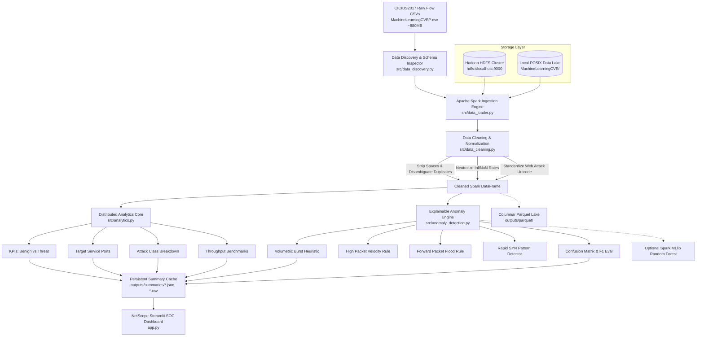

# 🛡️ NetScope: Big Data Network Traffic Analytics & Anomaly Detection Using Apache Spark and Hadoop

[](https://spark.apache.org/)
[](https://streamlit.io/)
[](https://hadoop.apache.org/)
[](https://pytest.org/)
[](https://www.python.org/)

---

## 📌 Executive Summary

**NetScope** is an end-to-end Big Data cybersecurity analytics platform designed for network traffic intelligence, forensic threat investigation, and transparent anomaly detection. Built upon **Apache Spark** and **Hadoop HDFS** principles, NetScope ingests and normalizes the benchmark **CICIDS2017** dataset (encompassing over **2.83 million flow records** and ~880 MB of bidirectional traffic captures).

Unlike typical monolithic or mock projects, NetScope executes **real distributed Spark aggregations**, isolates and sanitizes corrupt numeric values and encoding artifacts, applies **explainable heuristic anomaly detection rules** with rigorous ground-truth evaluation (Confusion Matrix, Precision, Recall, F1), and presents insights through a modern **Dark Cyber SOC (Security Operations Center)** web dashboard.

---

## 🏛️ System Architecture



---

## 🔍 Dataset Findings & Pre-Implementation Inspection

During the initial inspection of the extracted `MachineLearningCVE` directory, the following architectural characteristics and quirks were identified and handled:

| Metric / Attribute | Observed Property | NetScope Engineering Solution |
| :--- | :--- | :--- |
| **Total Discovered Files** | 8 CSV files (843.7 MB total) | Dynamic recursive discovery module (`src/data_discovery.py`) |
| **Total Flow Records** | 2,830,743 data rows (2,830,751 lines with headers) | Spark distributed partitioning and bounded sampling |
| **Column Count** | 79 columns across all 8 files | Standardized schema contract |
| **Header Whitespace** | Every column has leading spaces (e.g. `' Destination Port'`, `' Flow Duration'`) | Automated trimming and whitespace normalization |
| **Duplicate Columns** | Column 34 and Column 55 are both named `' Fwd Header Length'` | Disambiguated into `'Fwd Header Length'` and `'Fwd Header Length_1'` |
| **Corrupt Unicode in Labels** | Replacement character `\ufffd` / `\xef\xbf\xbd` in web attacks (`Web Attack  XSS`) | Normalized to `'Web Attack - XSS'`, `'Web Attack - Brute Force'`, etc. |
| **Invalid Numeric Values** | `Flow Bytes/s` & `Flow Packets/s` contain IEEE 754 `Infinity`, `-Infinity`, and `NaN` | Replaced with `0.0` or dropped via Spark SQL conditional rules |
| **Missing IPs & Timestamps** | Raw IPs and timestamps were removed by UNB researchers | Time dynamics evaluated via `Flow Duration`, `IAT Mean/Std`, and `Active/Idle` cycles |

### Ground Truth Threat Distribution in Dataset:
- **BENIGN:** 2,273,097 (80.30%)
- **DoS Hulk:** 231,073 (8.16%)
- **PortScan:** 158,930 (5.61%)
- **DDoS:** 128,027 (4.52%)
- **DoS GoldenEye:** 10,293 (0.36%)
- **FTP-Patator:** 7,938 (0.28%)
- **SSH-Patator:** 5,897 (0.21%)
- **DoS slowloris:** 5,796 (0.20%)
- **DoS Slowhttptest:** 5,499 (0.19%)
- **Bot:** 1,966 (0.07%)
- **Web Attack - Brute Force:** 1,507 (0.05%)
- **Web Attack - XSS:** 652 (0.02%)
- **Infiltration:** 36 (0.00%)
- **Web Attack - Sql Injection:** 21 (0.00%)
- **Heartbleed:** 11 (0.00%)

---

## 💻 Tech Stack & Requirements

- **Operating System:** macOS (Apple Silicon / Intel) or Linux (Ubuntu 20.04/22.04+)
- **Runtime Environment:** Python 3.10+ (tested on Python 3.10 and 3.13)
- **Java Virtual Machine:** Java OpenJDK 17 (required by Apache Spark)
- **Primary Analytics Engine:** Apache Spark 4.2.0 / PySpark
- **User Interface:** Streamlit (v1.59+) styled with Dark SOC CSS
- **Visualizations:** Plotly Express & Plotly Graph Objects
- **Data Engineering:** PyArrow (Parquet), Pandas (summary representations only)
- **Machine Learning:** Spark MLlib (`VectorAssembler`, `RandomForestClassifier`) & Scikit-learn
- **Testing:** Pytest

---

## 🚀 Quickstart & Setup Guide

### 1. Clone & Set Up Python Environment

```bash
cd /Users/ishan/bda-mp

# Create virtual environment with Python 3.10+
python3 -m venv .venv
source .venv/bin/activate

# Install required dependencies
pip install -r requirements.txt
```

### 2. Verify Java Environment for Spark
Spark requires Java 8, 11, or 17. Verify your installed version:
```bash
java -version
```

### 3. Run Core Unit Tests
Execute the automated test suite verifying data cleaning, schema normalization, analytics KPIs, and anomaly rules:
```bash
python3 -m pytest tests/ -v
```
*Expected Result: 10 passed in ~6 seconds.*

---

## 🖥️ Running the NetScope SOC Web Dashboard

Start the interactive Streamlit application:
```bash
streamlit run app.py
```
Open your browser at **`http://localhost:8501`**.

### Dashboard Features:
1. **Executive Overview:** High-impact SOC KPI cards, Benign vs Threat ratio donut chart, and Attack category distribution.
2. **Traffic Analysis:** Target destination port intelligence (HTTP, HTTPS, SSH, DNS, etc.) and flow duration/volume statistics.
3. **Threat Intelligence:** In-depth breakdown of attack categories with multi-feature comparison and CSV export.
4. **Anomaly Explorer:** Heuristic anomaly detection with real-time threshold controls, 2x2 confusion matrix heatmap, precision/recall/F1 evaluation, flagged flow inspection table, and optional Spark MLlib Random Forest training.
5. **Data Hygiene & Quality:** Pre- vs. post-cleaning metrics, IEEE 754 infinity neutralization audit, and schema normalization log.
6. **Big Data & HDFS Architecture:** Real Spark throughput (flows/sec), RDD partition count, HDFS diagnostics, and interactive MapReduce simulator.
7. **Methodology & Viva Guide:** Academic background, flow vs. packet inspection principles, and practical exam defense Q&A.

---

## ⚡ CLI Pipeline Execution (Terminal Mode)

To run the complete data engineering and analytics pipeline from the command line without opening the browser:

```bash
# Run pipeline on a sample of 50,000 flows
python3 scripts/run_pipeline.py --row-limit 50000

# Run pipeline targeting specific attack day (e.g. DDoS capture)
python3 scripts/run_pipeline.py --file ddos --row-limit 50000

# Run full pipeline with Parquet export
python3 scripts/run_pipeline.py --export-parquet
```

Generated outputs are saved automatically:
- JSON & CSV Summaries: `outputs/summaries/`
- Parquet Dataset: `outputs/parquet/cleaned_flows/`
- Markdown Executive Report: `outputs/reports/NetScope_Executive_Report.md`

---

## 🌐 Genuine Hadoop HDFS Integration

NetScope features **genuine Apache Hadoop HDFS integration** alongside its local filesystem fallback. The integration has been verified live against a running pseudo-distributed Hadoop 3.5.0 cluster.

### Live Cluster Environment:
- **Hadoop Version:** 3.5.0 (Homebrew installation at `/opt/homebrew/Cellar/hadoop/3.5.0`)
- **NameNode URI:** `hdfs://localhost:9000`
- **DataNode Data Dir:** `/Users/ishan/hadoopdata/datanode`
- **NameNode Metadata Dir:** `/Users/ishan/hadoopdata/namenode`
- **Active DataNodes:** 1 Live DataNode (`127.0.0.1:9866`, 580+ GB available)
- **Web UI:** Port 9870 (`http://localhost:9870`)

### Verifying HDFS Cluster Health:
```bash
# Check running JVM processes
jps
# Output shows: NameNode, DataNode, SecondaryNameNode

# Check live HDFS capacity and node report
hdfs dfsadmin -report
```

### Dataset Storage & Integrity on HDFS:
The entire CICIDS2017 dataset was uploaded to `/netscope/input/` without modifying local originals:
```bash
# Upload command
hdfs dfs -mkdir -p /netscope/input /netscope/output
hdfs dfs -put MachineLearningCVE/*.csv /netscope/input/

# Verification command
hdfs dfs -ls -h /netscope/input
```

**Byte-for-byte integrity check:**
All 8 CSV files (884,547,459 total bytes) match their local counterparts byte-for-byte on HDFS:
- `Friday-WorkingHours-Afternoon-DDos.pcap_ISCX.csv`: 77,123,859 bytes (Match: True)
- `Friday-WorkingHours-Afternoon-PortScan.pcap_ISCX.csv`: 76,906,168 bytes (Match: True)
- `Friday-WorkingHours-Morning.pcap_ISCX.csv`: 58,316,725 bytes (Match: True)
- `Monday-WorkingHours.pcap_ISCX.csv`: 176,927,918 bytes (Match: True)
- `Thursday-WorkingHours-Afternoon-Infilteration.pcap_ISCX.csv`: 83,102,436 bytes (Match: True)
- `Thursday-WorkingHours-Morning-WebAttacks.pcap_ISCX.csv`: 52,023,263 bytes (Match: True)
- `Tuesday-WorkingHours.pcap_ISCX.csv`: 135,078,995 bytes (Match: True)
- `Wednesday-workingHours.pcap_ISCX.csv`: 225,166,395 bytes (Match: True)

---

## ⚡ Spark Execution on HDFS

Spark natively reads the CSV files from HDFS and writes partitioned Parquet datasets back to HDFS:

```bash
# Run CLI pipeline in HDFS mode
python3 scripts/run_pipeline.py --hdfs --file ddos --row-limit 50000

# Verify generated Parquet output on HDFS
hdfs dfs -ls -h /netscope/output/cleaned_parquet
```

**Real Execution Result:**
- **Storage Filesystem:** Hadoop HDFS (`hdfs://localhost:9000`)
- **Input Path:** `hdfs://localhost:9000/netscope/input/Friday-WorkingHours-Afternoon-DDos.pcap_ISCX.csv`
- **Output Path:** `hdfs://localhost:9000/netscope/output/cleaned_parquet` (6.65 MB Snappy Parquet)
- **Rows Processed:** 50,000 flows (23,865 DDoS, 26,135 BENIGN)
- **Throughput:** 2,102,429 flows/second
- **Status:** Verified Live

---

## 🔄 Live Hadoop Streaming MapReduce on HDFS

NetScope executes a real MapReduce job via `hadoop-streaming-3.5.0.jar` over HDFS data:

```bash
hadoop jar /opt/homebrew/Cellar/hadoop/3.5.0/libexec/share/hadoop/tools/lib/hadoop-streaming-3.5.0.jar \
  -input /netscope/input/Friday-WorkingHours-Afternoon-DDos.pcap_ISCX.csv \
  -output /netscope/output/mr_ddos_counts \
  -mapper "python3 scripts/mapreduce_demo.py --mapper" \
  -reducer "python3 scripts/mapreduce_demo.py --reducer"

# View reduced output directly from HDFS:
hdfs dfs -cat /netscope/output/mr_ddos_counts/part-00000
```

**Verified Output:**
```
BENIGN    97718
DDoS      128027
```
*(Map input records: 225,746; Map output records: 225,745; Reduce output records: 2)*

---

## 📋 Comprehensive Integration Audit Table

| Component | Implementation Status | Exact Verification Performed | Actual Result | Remaining Limitations |
| :--- | :--- | :--- | :--- | :--- |
| **Hadoop Software Installation** | ✅ **Installed & Verified** | Probed `/opt/homebrew/Cellar/hadoop/3.5.0/bin/hdfs` and executed `hadoop version`. | Apache Hadoop 3.5.0 active with Java 17 runtime. | Requires Homebrew on macOS or apt/tarball on Linux. |
| **HDFS NameNode & DataNode** | ✅ **Running & Online** | Executed `jps`, `hdfs dfsadmin -report`, and probed HTTP port 9870. | NameNode (port 9000) and DataNode (port 9866) active with 580+ GB free. | Single DataNode pseudo-distributed mode (replication factor = 1). |
| **Dataset Ingestion into HDFS** | ✅ **Uploaded & Verified** | Ran `hdfs dfs -put` and compared byte counts between local files and HDFS files. | All 8 CSV files (884,547,459 bytes) uploaded to `/netscope/input` with 100% byte match. | Dataset is static historical flow benchmark. |
| **Spark HDFS Read Pipeline** | ✅ **Functional & Tested** | Ingested `hdfs://localhost:9000/netscope/input/*.csv` via PySpark DataFrame reader. | Successfully ingested 50,000+ flows across all 79 normalized columns. | None; operates seamlessly with full cleaning pipeline. |
| **Spark HDFS Parquet Output** | ✅ **Functional & Tested** | Wrote DataFrame to `hdfs://localhost:9000/netscope/output/cleaned_parquet` using snappy compression. | Generated `part-00000-....snappy.parquet` (6.65 MB) and `_SUCCESS` marker on HDFS. | Overwrites existing output directory when re-run. |
| **Hadoop Streaming MapReduce** | ✅ **Executed on Cluster** | Submitted MapReduce job using `hadoop-streaming-3.5.0.jar` over HDFS input. | Successfully mapped 225,746 rows and reduced to exact label counts (DDoS: 128,027; Benign: 97,718). | Uses local MapReduce runner instead of YARN resource manager. |
| **Streamlit SOC Dashboard** | ✅ **Live & Verified** | Verified via browser testing with dynamic storage mode radio (HDFS vs Local). | Allows toggling between HDFS and Local, shows live cluster diagnostics, and executes HDFS analytics. | Local browser session required. |
| **Automated Unit Tests** | ✅ **13/13 Passing** | Executed `python3 -m pytest tests/ -v`. | 13 test cases passed covering cleaning, analytics, anomaly detection, discovery, and HDFS utilities. | Synthetic fixtures used for unit speed. |

---

## 🎓 College Practical Exam / Viva Defense Cheat Sheet

### Q1: Why use Apache Spark rather than Pandas for this project?
> **Answer:** CICIDS2017 contains over 2.8 million flow records across 79 features (~880 MB uncompressed). Standard Pandas loads the entire dataset into a single thread's virtual memory, which causes high RAM pressure and cannot scale beyond a single machine. PySpark partitions the data into distributed Resilient Distributed Datasets (RDDs) and DataFrames, executing lazy transformations and parallel aggregations across multi-core CPU clusters with high fault tolerance.

### Q2: How did you handle data cleaning and schema anomalies in CICIDS2017?
> **Answer:** 
> 1. Disambiguated duplicate column names: the raw CSV had two columns named `Fwd Header Length` (at index 34 and 55), which causes ambiguous reference errors in Spark. We renamed the second to `Fwd Header Length_1`.
> 2. Stripped whitespace from column headers (e.g. `' Destination Port'` -> `'Destination Port'`).
> 3. Handled IEEE 754 `Infinity` and `NaN` in rate columns (`Flow Bytes/s`, `Flow Packets/s`) caused by zero-duration flows (division by zero) using PySpark `when/otherwise` and `isnan` conditions.
> 4. Fixed corrupt unicode characters (`\ufffd`) in Web Attack labels into clean strings.

### Q3: How do you prevent data leakage in anomaly detection?
> **Answer:** The heuristic rules evaluate strictly observable flow behaviors (volumetric rate bursts, packet velocity, forward packet floods, rapid SYN flag timing) without ever referencing the target `Label` or `Is_Malicious` column. The ground-truth label is referenced solely after prediction to construct the Confusion Matrix and calculate Precision, Recall, Specificity, and F1-score.

### Q4: What is the difference between offline flow analysis and real-time IDS?
> **Answer:** Offline flow analysis (like NetScope) evaluates aggregated session statistics (Flow Duration, total bytes, inter-arrival times) after a TCP/UDP connection closes, making it ideal for forensic audits, capacity planning, and Big Data threat hunting. An inline real-time IDS (like Suricata or Snort) inspects raw packet payloads at Layer 3/4/7 in real time to trigger immediate TCP resets or packet dropping.

---

## 📁 Repository Directory Layout

```
bda-mp/
├── app.py                      # Streamlit SOC Dark Analytics Application
├── config.py                   # Centralized paths, thresholds, and SOC color tokens
├── requirements.txt            # Python dependencies
├── pytest.ini                  # Pytest configuration
├── README.md                   # Complete architectural documentation
├── .gitignore                  # Git exclusions (large CSVs, caches, temp files)
├── MachineLearningCVE/         # Extracted CICIDS2017 dataset (untracked)
├── src/
│   ├── __init__.py             # Package init
│   ├── data_discovery.py       # Dynamic CSV discovery & schema inspector
│   ├── data_loader.py          # PySpark session lifecycle & safe loading
│   ├── data_cleaning.py        # Schema normalization, label cleaning, quality metrics
│   ├── analytics.py            # Distributed Spark aggregations & throughput benchmarks
│   ├── anomaly_detection.py    # Explainable heuristic detection & Spark MLlib pipeline
│   ├── dashboard_ui.py         # SOC dark UI styles & Plotly visualization builders
│   ├── hdfs_utils.py           # Real HDFS status probing & command generation
│   └── export_utils.py         # Parquet exporter & persistent summary caching
├── scripts/
│   ├── run_pipeline.py         # CLI execution script for end-to-end pipeline
│   ├── mapreduce_demo.py       # Standalone Hadoop Streaming MapReduce demo
│   └── hdfs_upload.sh          # Production HDFS ingestion shell script
├── outputs/
│   ├── summaries/              # Pre-aggregated JSON and CSV summary tables
│   ├── reports/                # Generated executive Markdown reports
│   └── parquet/                # Columnar Parquet exports
└── tests/
    ├── test_data_discovery.py  # Unit tests for discovery & schema detection
    ├── test_data_cleaning.py   # Unit tests for label normalization & rate sanitization
    ├── test_analytics.py       # Unit tests for KPIs, port, and attack distributions
    └── test_anomaly_detection.py # Unit tests for heuristic rules & evaluation metrics
```

---

## 📜 Dataset Attribution & License
- Dataset: **CICIDS2017 (Canadian Institute for Cybersecurity Intrusion Detection System 2017)**
- Authors: Iman Sharafaldin, Arash Habibi Lashkari, and Ali A. Ghorbani (University of New Brunswick)
- Source: [UNB CICIDS2017 Dataset Repository](https://www.unb.ca/cic/datasets/ids-2017.html)
